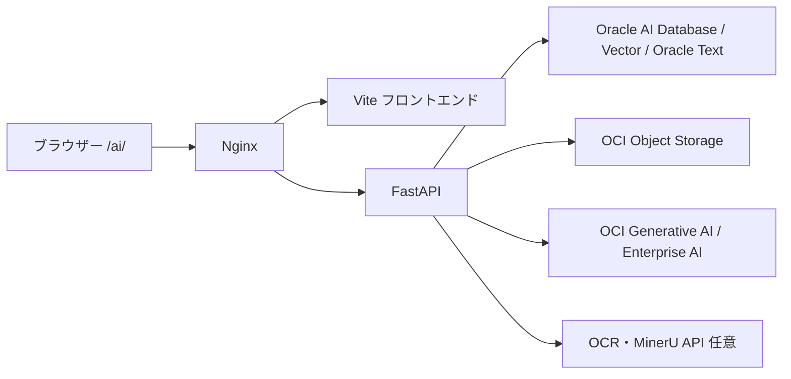

# 資料見つかるくん — Semantic Document Search

Oracle AI DatabaseとOCIを使う、文書管理・マルチモーダル検索アプリです。
文書を登録・分類し、自然言語、画像、AIが抽出したタグから関連資料を探せます。

## 主な機能

- 文書の登録、一覧、メタデータ・分類候補の確認、ダウンロード。
- 自然言語・画像・タグによる検索と、関連文書の表示。
- OCR / MinerU / VLMによる抽出、ベクトル化、処理履歴・進捗・再試行。
- VLM抽出プロファイル、検索設定、DB・OCI接続の管理。
- AIアシスタントとDify連携（任意）。

同梱の分類ルールとVLMプロファイルは、日本語の住宅施工写真・提案図面を主な対象にしています。
別分野で使う場合は、設定画面から分類ルール、タグ、抽出プロファイルを用途に合わせて変更してください。



## OCIへデプロイする

[](https://cloud.oracle.com/resourcemanager/stacks/create?zipUrl=https://github.com/yushibats/no.1-semantic-doc-search-yushibats/releases/latest/download/semantic-doc-search-stack.zip)

1. [OCIへの導入手順](docs/deployment.md)で必要な権限・ネットワーク・サービスを確認します。
2. 上のボタンからOCIへサインインし、デプロイ先リージョンとコンパートメントを選びます。
3. 画面に表示される変数を設定し、Planを確認してからApplyします。
4. DBとOCIを設定し、[サンプル文書](docs/sample-document.md)で登録・検索を確認します。

ボタンは、GitHubで公開されている最新Releaseの`semantic-doc-search-stack.zip`を読み込みます。
ドラフトまたはプレリリースだけが存在する状態では利用できません。手動アップロードと
パッケージ作成の方法は[OCIへの導入手順](docs/deployment.md)に記載しています。
作成するCompute・ADB・ストレージ・AI利用には料金が発生します。
接続情報・文書・DBデータは利用者ごとに用意します。

## 開発する

必要なもの: Python 3.13、uv、Node.js 20.19以上、npm。
DB・OCIへの接続と、文書変換に必要なOS依存関係については[開発手順](docs/development.md)を参照してください。

```bash
cp .env.example .env
uv sync --directory backend --locked --python 3.13 --group dev
npm ci --prefix frontend
```

`.env`を設定後、別々のターミナルで起動します。

```bash
bash scripts/start-backend.sh
```

```bash
bash scripts/start-frontend.sh
```

ブラウザーで`http://localhost:5175/ai/`を開きます。

## ドキュメント

| 目的 | 説明 |
|---|---|
| OCIに新規導入する | [導入手順・404の切り分け](docs/deployment.md) |
| DB、AI、OCRを設定する | [設定項目](docs/configuration.md) |
| 開発・検証する | [ローカル開発とテスト](docs/development.md) |
| 更新・共有・削除する | [運用とリリース](docs/operations.md) |
| 動作確認用の文書を使う | [架空のサンプル文書](docs/sample-document.md) |

## 変更とリリース

PRでバックエンドテスト、UIテスト、ビルド、Terraform、配布スクリプトを検証します。
`main`へのマージ後に`v*`タグをpushすると、検証済みコミットから配布物を生成し、
GitHubのドラフトリリースへ添付します。導入確認後に公開してください。
配布ZIPには取得元のコミットSHAとファイルハッシュを記録します。

## データとライセンス

このリポジトリに実際の`.env`、認証キー、Wallet、顧客文書、DBダンプ、バックアップは含めません。
サーバー上で設定したモデル・検索プロファイル・登録文書は別途管理します。
本体のライセンスは[MIT](LICENSE.txt)です。依存ライブラリと同梱素材については
[第三者のライセンス・帰属表示](THIRD_PARTY_NOTICES.md)を参照してください。
